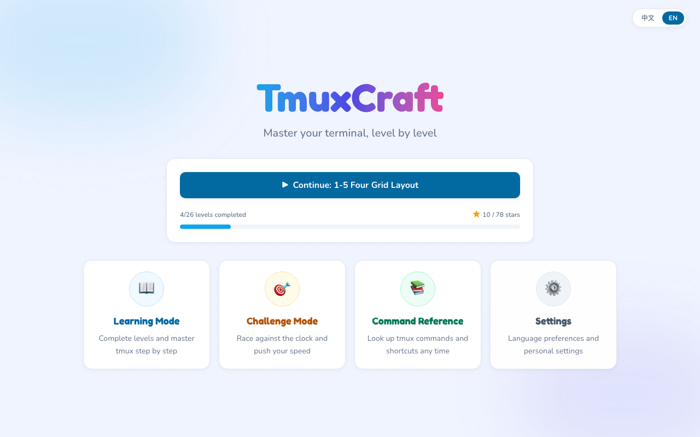
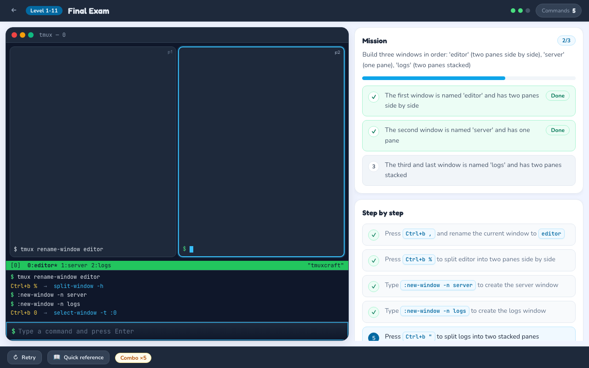
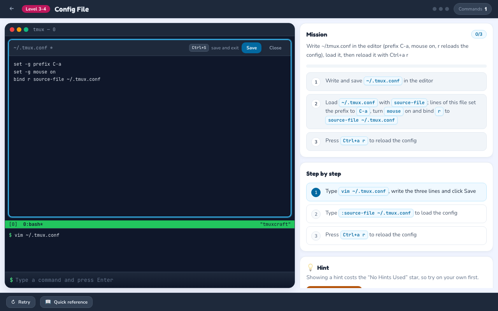
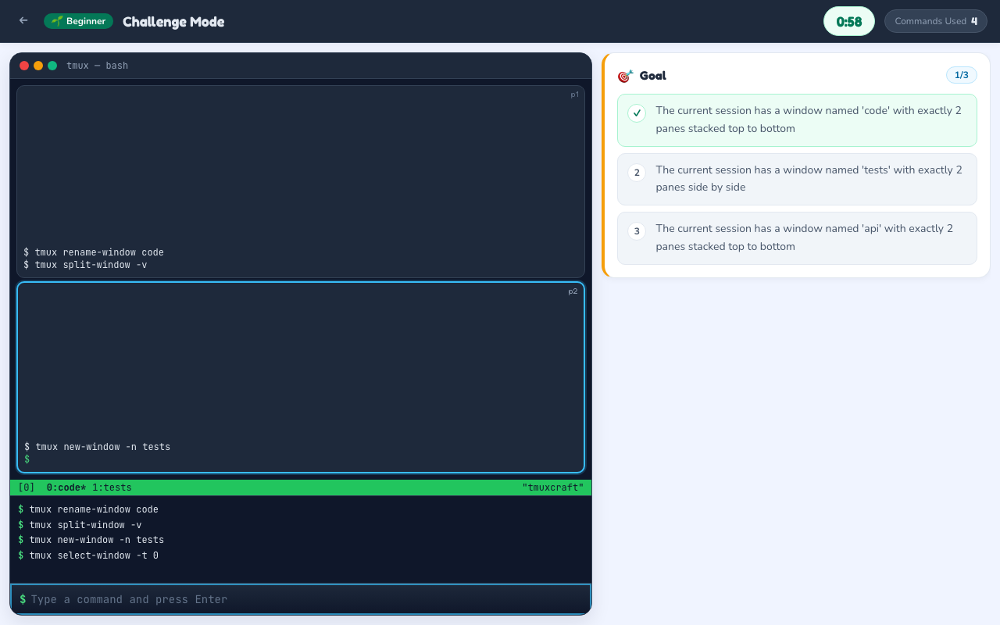
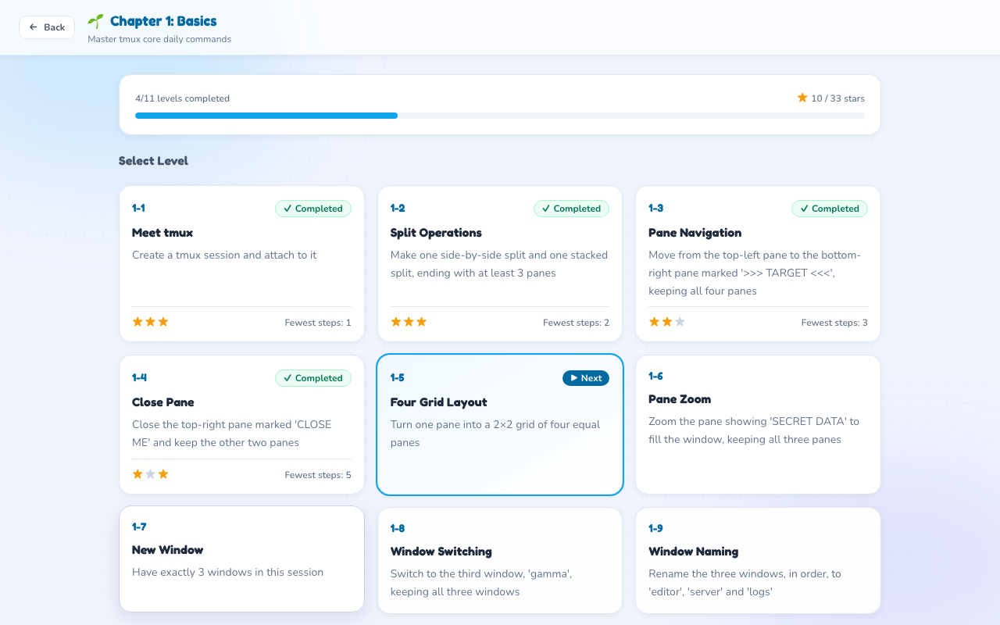
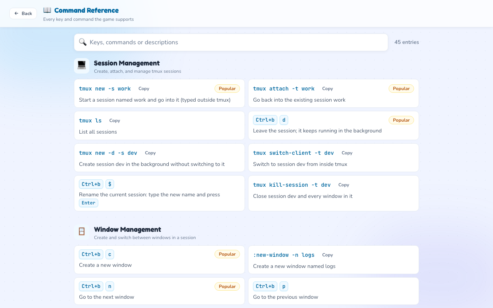

# TmuxCraft

**Master your terminal, level by level.**

English | [简体中文](README.zh-CN.md)

TmuxCraft is a browser game that teaches tmux. Each level puts you in a simulated terminal where you type real tmux commands and press real prefix keys until every objective is ticked. Nothing touches your real shell, so you can experiment freely.

> tmux is the developer's command centre in the AI era. Whether you run a team of Claude Code agents in parallel or simply split the screen to juggle everyday tasks, tmux is the foundation of working efficiently in a terminal. TmuxCraft helps you master it in the browser.

## Screenshots

**Home**



**A level in play: split panes on the left, objectives on the right**



**Writing `~/.tmux.conf` in the built-in editor (chapter 3)**



**A challenge round**



**Level select**



**Cheat sheet**



## Features

- **26 levels in 3 chapters**: Basics (11), Advanced (8) and Customization (7), from your first `tmux new` to writing your own config and session script.
- **Three ways to give input**, all backed by one command table: shell lines, the tmux command prompt and prefix keys.
- **A simulator that behaves like tmux**: `-t session:window.pane` targets, copy mode, `send-keys`, `synchronize-panes`, a custom prefix and `bind-key`, mouse mode, status bar options, config files and shell scripts.
- **3 stars per level** for finishing, finishing efficiently and finishing without hints.
- **Challenge mode** with three difficulties, random goals and a countdown.
- **Searchable cheat sheet**; every entry in it is tested to run in the simulator.
- **中文 / English** interface, switchable at any time from the home screen or settings.
- **Accessible and responsive**: visible keyboard focus, respects the reduced-motion setting, and on narrow screens the terminal and objectives stack.
- **Local only**: progress and best rounds are kept in your browser's localStorage. No accounts, no server. Progress from earlier versions is migrated.

## Quick start

```bash
git clone https://github.com/codedev-xy/tmuxcraft.git
cd tmuxcraft
npm install
npm run dev
```

Then open http://localhost:5173.

## How to play

There are three ways to run a command, and you can mix them freely:

| Style | Example |
|---|---|
| Type a shell line | `tmux split-window -h` |
| Open the command prompt with `Ctrl+b :`, then type | `split-window -h` |
| Press the prefix, then a key | `Ctrl+b %` |

**Stars.** Each level awards up to three: one for completing it, one for using no more than 1.5 times the optimal number of steps (rounded up), and one for not using any hints. Each level has three hints, revealed one at a time; the first one costs the no-hints star.

**Checking.** Objectives are checked against the resulting state, and against the command log where *how* you did it matters (for example, that a pane was split with your own key binding, or that a session was created by your script rather than by hand).

**Challenge mode.** Pick a difficulty and get a random list of tasks, ticked live as you go:

- Beginner, 60 s: two or three named windows, each split a given way.
- Intermediate, 90 s: one of several setups, such as even layouts, a 2x2 grid, synchronized panes or a zoomed pane.
- Advanced, 120 s: two named sessions with shaped windows, plus one global option.

The best round for each difficulty is shown on its card. All levels and difficulties are open from the start.

## What the simulator covers

The simulator in `src/core/` is a set of pure functions over a `TmuxState` value, not a wrapper around real tmux. It supports the commands the levels and the cheat sheet use:

- Sessions, windows and panes: create, kill, rename, select, list, attach, detach, `switch-client`, resize, zoom, swap, `break-pane`, `join-pane`, `move-window`, `swap-window` and the five preset layouts.
- Full `-t session:window.pane` targets.
- Copy mode: enter, move (arrows or `hjkl`), select, copy, and paste with `Ctrl+b ]`.
- `send-keys`, `synchronize-panes`, `display-message`, `command-prompt`, `confirm-before`.
- Options: `set -g prefix` and `bind-key` / `unbind-key` really change which keys work; with `mouse on` you can click a pane to select it and drag a border to resize; `status-*` options change the status bar; plus `mode-keys`, border styles and a few more.
- A small virtual home directory with a built-in multi-line editor (opened by `vim`, `vi` or `nano`), `ls`, `cat` and `echo`. `source-file` runs a config line by line and `bash <file>` runs a script. Chapter 3 uses this to have you write a real `~/.tmux.conf` and a session script, then load and run them.
- Helpful errors: "did you mean ...?" suggestions for typos, and the nested-session error when you run `tmux new -s x` inside tmux without `-d`.

**Limits.** This is a teaching simulator. Any real tmux command outside this set answers that it is not supported by the simulator yet, and so do common options it does not model (such as `base-index`). The shell has no pipes or redirects, and common programs such as `git` or `npm` are accepted but print nothing.

## Browser key caveats

Browsers and operating systems keep some keys for themselves. A web page can never take `Ctrl+w`, `Ctrl+t` or `Ctrl+n` away from the browser, so the game refuses them as a prefix or key binding. Firefox may also act on `Ctrl+b`, macOS uses `Ctrl+arrow` for Mission Control, and `Ctrl+a` is select-all. Every key action has a typed equivalent, so nothing is blocked: `Ctrl+b %` is `tmux split-window -h`, `Ctrl+b Ctrl+arrow` is `tmux resize-pane -L` (or `-R`, `-U`, `-D`), and so on.

## Scripts

| Command | What it does |
|---|---|
| `npm run dev` | Start the Vite dev server |
| `npm run build` | Type-check, then build for production |
| `npm run lint` | Run ESLint |
| `npm run typecheck` | Type-check with `tsc -b` |
| `npm test` | Run the unit and component tests (Vitest) |
| `npm run coverage` | Run the tests with coverage |
| `npm run test:e2e` | Run the Playwright smoke tests |
| `npm run preview` | Preview the production build |

There are about 1,900 unit and component tests in 82 files, plus Playwright smoke tests in `e2e/`. Every level has an executable reference solution and a level-table test: the level is not complete at the start, the solution completes it in exactly the optimal number of steps, and known shortcuts do not pass.

## Project structure

```
src/
├── core/        # The tmux simulator: pure functions for commands, keys, layout, shell and files
├── game/        # Levels, validators, scoring, challenge generator, cheat-sheet data, input simulation
├── components/  # React UI: screens, game, challenge, reference and shared ui components
├── hooks/       # Simulator session wrapper, key capture, clock
├── store/       # Zustand stores: current game, and saved progress with migration
├── i18n/        # en.json, zh.json and language setup
└── styles/      # Tailwind v4 theme and global styles
```

Every key press, typed line or editor save becomes one input that `applyInput` in `src/game/sim/simulate.ts` passes to the core: lines go through the simulated shell, while prompt lines and key bindings resolve into the same command table, producing a new `TmuxState`. The UI renders that state and the validators check it; the tests drive the same function.

## Tech stack

- React 19 and TypeScript
- Vite 7
- Tailwind CSS v4
- Zustand
- Framer Motion
- react-i18next
- Vitest and Testing Library
- Playwright

## Contributing

Issues and pull requests are welcome. Before opening a pull request, make sure `npm run lint`, `npm run typecheck` and `npm test` all pass.

- **Levels** live in `src/game/levels/`. A level defines its initial state, objectives with validators, hints, an optimal step count and a reference solution. Add its text to both `src/i18n/en.json` and `src/i18n/zh.json`.
- **Commands** live in `src/core/commands/`. Add tests with any new command, and a cheat-sheet entry in `src/game/reference.ts` if players should find it.

## License

MIT
