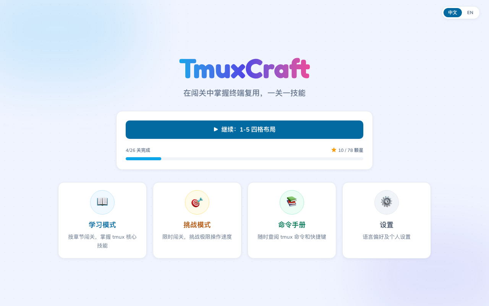
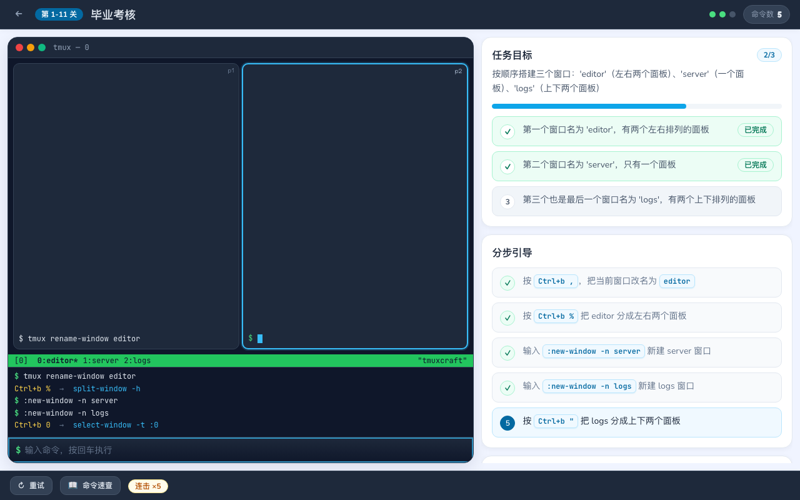
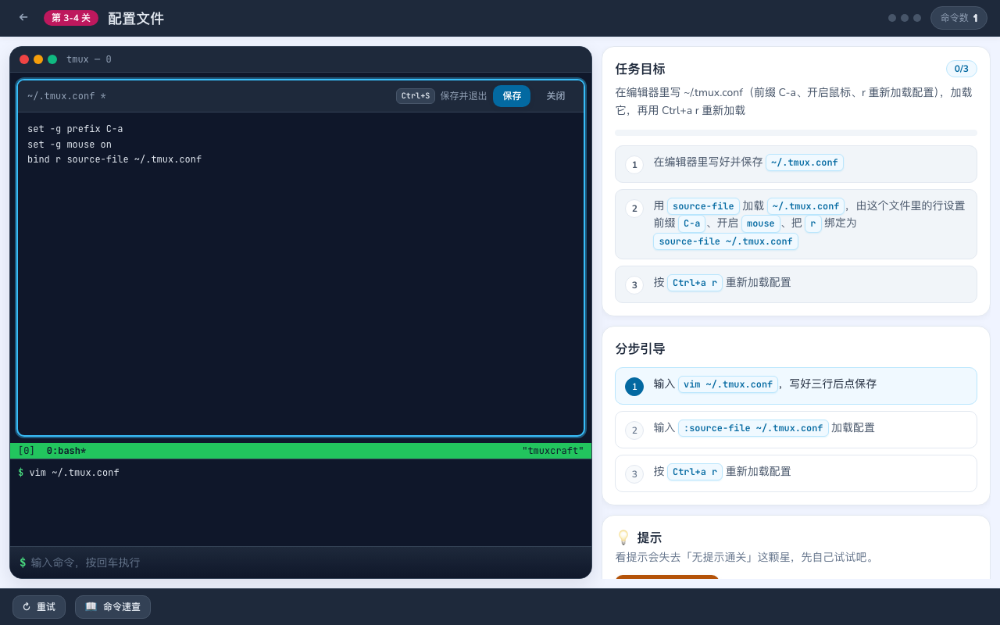
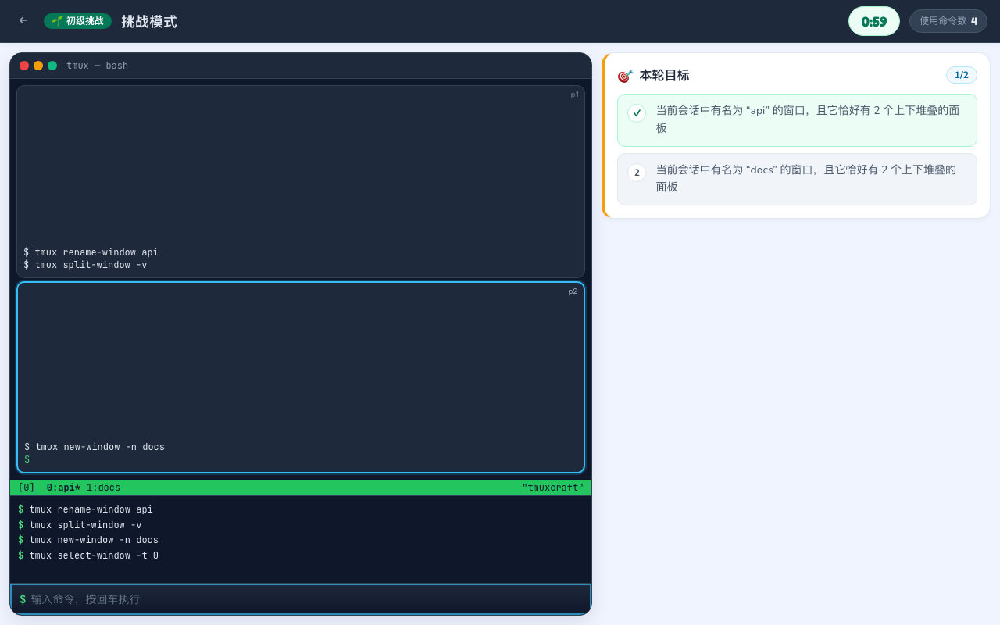
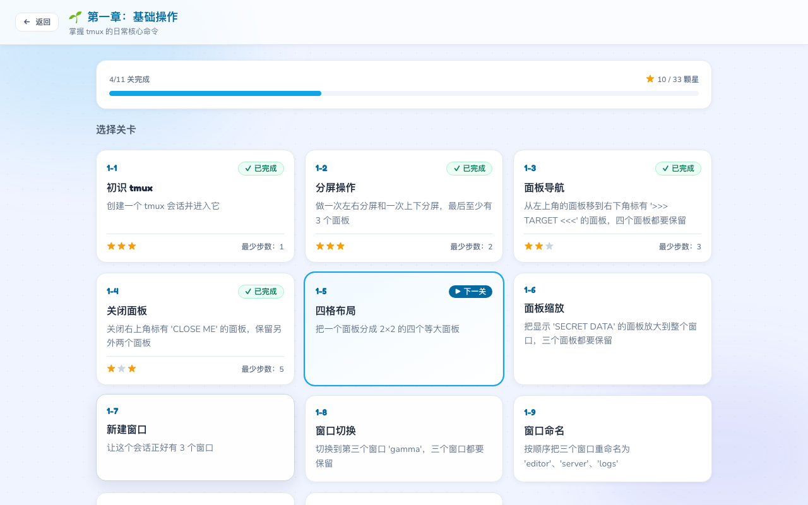
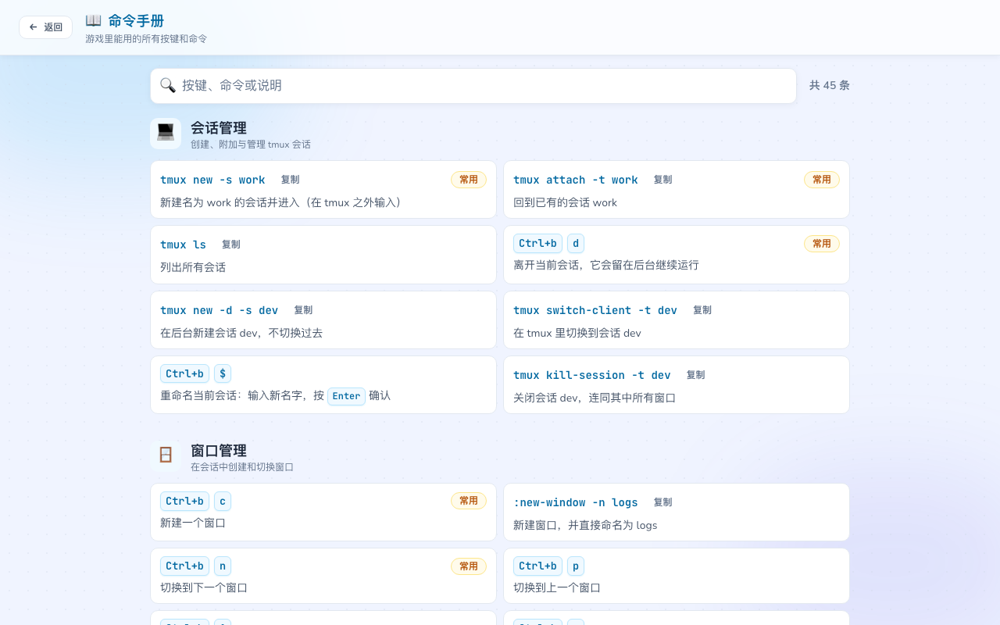

# TmuxCraft

**在闯关中掌握终端复用，一关一技能。**

[English](README.md) | 简体中文

TmuxCraft 是一个在浏览器里学 tmux 的闯关游戏。每一关都给你一个模拟终端，你要输入真实的 tmux 命令、按真实的前缀键，把右侧的目标逐个完成。所有操作都不会碰到你本机的 shell，可以放心随便试。

> tmux 是 AI 时代开发者的「指挥中心」。无论是用 Claude Code Agent Teams 多 Agent 并行开发，还是日常分屏多任务，tmux 都是终端效率的基石。TmuxCraft 帮你在浏览器里轻松掌握它。

## 截图

**首页**



**闯关中：左边是分好的面板，右边是目标**



**第三章：在内置编辑器里写 `~/.tmux.conf`**



**挑战模式的一局**



**选择关卡**



**命令手册**



## 功能

- **3 章 26 关**：基础操作（11 关）、进阶操作（8 关）、高级定制（7 关），从第一次敲 `tmux new` 一路到自己写配置文件和会话脚本。
- **三种输入方式**，背后是同一张命令表：shell 命令行、tmux 命令提示符、前缀键。
- **模拟器的行为和 tmux 一致**：`-t session:window.pane` 目标、复制模式、`send-keys`、`synchronize-panes`、自定义前缀和 `bind-key`、鼠标模式、状态栏选项、配置文件和 shell 脚本。
- **每关 3 颗星**：通关、步数够少、没看提示，各一颗。
- **挑战模式**：三档难度，题目随机生成，限时完成。
- **可搜索的命令手册**，每一条都有测试保证能在模拟器里跑通。
- **中文 / English 界面**，随时可以在首页或设置里切换。
- **无障碍与自适应**：键盘焦点清晰可见，尊重系统的“减少动态效果”设置；窄屏下终端和目标上下排列。
- **纯本地**：进度和最佳成绩都存在浏览器的 localStorage 里，没有账号，也没有服务器。旧版本的存档会自动迁移。

## 快速开始

```bash
git clone https://github.com/codedev-xy/tmuxcraft.git
cd tmuxcraft
npm install
npm run dev
```

然后在浏览器打开 http://localhost:5173。

## 怎么玩

执行命令有三种方式，可以随意混用：

| 方式 | 例子 |
|---|---|
| 在 shell 里输入一行命令 | `tmux split-window -h` |
| 按 `Ctrl+b :` 打开命令提示符，再输入 | `split-window -h` |
| 先按前缀键，再按一个键 | `Ctrl+b %` |

**星级。** 每关最多 3 颗星：通关一颗；所用步数不超过最优步数的 1.5 倍（向上取整）一颗；一次提示都没看再一颗。每关有三条提示，逐条揭开，看了第一条就拿不到“无提示”那颗星。

**判定。** 目标检查的是操作之后的状态；如果“怎么做到的”也重要，还会查命令记录。比如面板是不是用你自己绑定的键分出来的，会话是不是由你的脚本创建、而不是手动敲出来的。

**挑战模式。** 选一档难度，拿到一组随机任务，做完一项就实时勾掉一项：

- 初级，60 秒：两到三个指定名字的窗口，每个按要求分屏。
- 中级，90 秒：从几类布局里随机出一题，比如均分布局、2x2 四宫格、同步面板或放大某个面板。
- 高级，120 秒：两个指定名字的会话，各自的窗口要分成指定形状，另外再设置一个全局选项。

每档难度的最佳成绩显示在对应卡片上。所有关卡和难度一开始就全部开放。

## 模拟器能做什么

`src/core/` 里的模拟器是一组作用于 `TmuxState` 的纯函数，并不是在调用真实的 tmux。关卡和命令手册用到的命令它都支持：

- 会话、窗口、面板：新建、关闭、重命名、选择、列出、attach、detach、`switch-client`、调整大小、放大、交换、`break-pane`、`join-pane`、`move-window`、`swap-window`，以及五种预设布局。
- 完整的 `-t session:window.pane` 目标写法。
- 复制模式：进入、移动（方向键或 `hjkl`）、选择、复制，再用 `Ctrl+b ]` 粘贴。
- `send-keys`、`synchronize-panes`、`display-message`、`command-prompt`、`confirm-before`。
- 选项：`set -g prefix` 和 `bind-key` / `unbind-key` 会真的改变哪些键能用；打开 `mouse on` 后可以点击选中面板、拖动边框调整大小；`status-*` 选项会改变状态栏；另外还有 `mode-keys`、边框样式等少量选项。
- 一个小小的虚拟家目录，带内置的多行编辑器（用 `vim`、`vi` 或 `nano` 打开），以及 `ls`、`cat`、`echo`。`source-file` 会逐行执行配置文件，`bash <file>` 会执行脚本。第三章就是让你用它写一份真正的 `~/.tmux.conf` 和一个会话脚本，再加载、运行。
- 友好的报错：输错命令时提示“你是不是想输入……”；在 tmux 里不加 `-d` 运行 `tmux new -s x` 时，会给出嵌套会话的错误。

**限制。** 这是一个教学用的模拟器。超出上述范围的真实 tmux 命令，以及 `base-index` 这类没有模拟的常用选项，都会直接告诉你模拟器暂不支持。shell 不支持管道和重定向；`git`、`npm` 这类常用程序可以输入，但不会有任何输出。

## 浏览器按键说明

有些按键会先被浏览器或操作系统拿走。`Ctrl+w`、`Ctrl+t`、`Ctrl+n` 网页根本抢不过来，所以游戏不允许把它们设为前缀或绑定键。另外，Firefox 可能会自己响应 `Ctrl+b`，macOS 的“调度中心”占用了 `Ctrl+方向键`，`Ctrl+a` 则是全选。好在每个按键操作都有等价的命令可以输入，不会卡关：`Ctrl+b %` 就是 `tmux split-window -h`，`Ctrl+b Ctrl+方向键` 就是 `tmux resize-pane -L`（或 `-R`、`-U`、`-D`），以此类推。

## 脚本

| 命令 | 作用 |
|---|---|
| `npm run dev` | 启动 Vite 开发服务器 |
| `npm run build` | 先做类型检查，再构建生产版本 |
| `npm run lint` | 运行 ESLint |
| `npm run typecheck` | 用 `tsc -b` 做类型检查 |
| `npm test` | 运行单元测试和组件测试（Vitest） |
| `npm run coverage` | 运行测试并统计覆盖率 |
| `npm run test:e2e` | 运行 Playwright 冒烟测试 |
| `npm run preview` | 预览生产构建 |

目前有约 1,900 个单元测试和组件测试，分布在 82 个文件里，另有 Playwright 冒烟测试放在 `e2e/`。每一关都有一份可执行的参考解法和一组关卡表测试：开局时不算通关，参考解法恰好用最优步数通关，已知的取巧路线过不了。

## 项目结构

```
src/
├── core/        # tmux 模拟器：命令、按键、布局、shell、文件，全是纯函数
├── game/        # 关卡、校验器、计分、挑战题目生成、命令手册数据、输入模拟
├── components/  # React 界面：各个页面、闯关、挑战、命令手册和通用 ui 组件
├── hooks/       # 模拟器会话封装、按键捕获、计时
├── store/       # Zustand 状态：当前对局，以及带迁移的存档进度
├── i18n/        # en.json、zh.json 和语言设置
└── styles/      # Tailwind v4 主题和全局样式
```

每一次按键、输入的一行命令或编辑器里的一次保存，都会变成一条输入，由 `src/game/sim/simulate.ts` 里的 `applyInput` 交给核心层处理：命令行先经过模拟 shell，命令提示符和按键绑定最终都落到同一张命令表上，产出新的 `TmuxState`。界面负责渲染这个状态，校验器负责检查它；测试走的也是同一个函数。

## 技术栈

- React 19 和 TypeScript
- Vite 7
- Tailwind CSS v4
- Zustand
- Framer Motion
- react-i18next
- Vitest 和 Testing Library
- Playwright

## 参与贡献

欢迎提 Issue 和 Pull Request。提 PR 之前，请确认 `npm run lint`、`npm run typecheck` 和 `npm test` 全部通过。

- **关卡**在 `src/game/levels/`。一关包括初始状态、带校验函数的目标、提示、最优步数和参考解法。文案要同时加到 `src/i18n/en.json` 和 `src/i18n/zh.json`。
- **命令**在 `src/core/commands/`。新增命令请一并补上测试；如果希望玩家能查到，再在 `src/game/reference.ts` 里加一条命令手册条目。

## License

MIT
